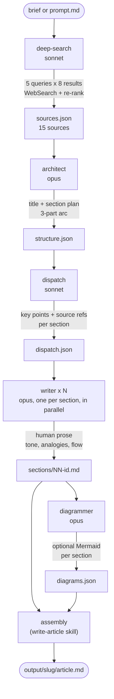

# article-companion

A Claude Code plugin that writes high-quality Medium-style articles from a one-line brief. You describe a topic; a pipeline of specialized Claude subagents researches it, designs a structure, fills it with sourced substance, writes human-sounding prose, and optionally adds explanatory diagrams, all from one command.

---

## How it works

The `write-article` skill drives a fixed sequence of 5 subagents. Each one writes a file the next one reads. There is no dynamic routing or supervisor: the flow is deterministic.



### Agents in detail

| Agent | Model | Role |
|---|---|---|
| **deep-search** | `sonnet` | Generates 5 search queries, runs them with `WebSearch` (up to 8 results each), deduplicates, then re-ranks to keep the 15 most relevant sources. |
| **architect** | `opus` | Designs the article structure: a compelling title (must contain a number, claim, or tension), a hook intro, body sections with standalone headings, and a conclusion with a CTA. Word budget is derived from the brief. |
| **dispatch** | `sonnet` | For each section, extracts the key points and substance from the sources. Produces bullet facts and source references, no prose yet. |
| **writer** | `opus` | Writes one section as final Markdown prose: analogy-first explanations, conversational tone, enforced Medium voice and formatting rules. Hook rules apply to the first section, conclusion/CTA rules to the last. |
| **diagrammer** | `opus` | Evaluates each section and, where a diagram genuinely helps, produces a Mermaid diagram with a caption. Sections where a visual adds nothing are skipped. |

### Data flow (files in the run directory)

```
deep-search → sources.json    { queries, candidateCount, sources: [{ id, title, url, snippet, relevance }] }
architect   → structure.json  { title, targetWordCount, sections: [{ id, heading, description, estimatedWords }] }
dispatch    → dispatch.json   { sections: [{ ...section, keyPoints, sourceRefs }] }
writer      → sections/NN-id.md   (section body, no heading)
diagrammer  → diagrams.json   { diagrams: [{ sectionId, include, mermaid, caption }] }
skill       → article.md
```

---

## Project structure

```
.claude-plugin/
  plugin.json              # plugin manifest
  marketplace.json         # lets you install the plugin from this repo
agents/
  deep-search.md           # 15 best sources via WebSearch + ranking
  architect.md             # article structure + title rules
  dispatch.md              # substance mapping per section
  writer.md                # prose generation for one section
  diagrammer.md            # optional Mermaid diagrams
skills/
  write-article/SKILL.md   # orchestrator: runs the 5 agents, assembles article.md
prompt.example.md          # brief template
output/                    # generated runs (gitignored)
```

---

## Setup

### Prerequisites

- [Claude Code](https://claude.com/claude-code) with access to the `WebSearch` tool.

No API key or runtime is needed: everything runs inside Claude Code.

### Install

From Claude Code, add this repository as a marketplace and install the plugin:

```
/plugin marketplace add Val1t3/article-companion
/plugin install article-companion@article-companion
```

For local development, point the marketplace at your clone instead:

```
/plugin marketplace add /path/to/article-companion
```

Or load it for a single session: `claude --plugin-dir /path/to/article-companion`.

---

## Usage

### Option A: brief inline

```
/article-companion:write-article Write a 2000-word article for senior engineers about the trade-offs of event-driven architecture vs. request-response in distributed systems.
```

You can also just ask Claude to write an article: the skill triggers on its own.

### Option B: brief in `prompt.md`

```bash
cp prompt.example.md prompt.md
```

Edit `prompt.md`, then run `/article-companion:write-article` with no argument.

The brief is in English. You can specify a target length and audience; if you don't, the architect defaults to a ~1200-word article.

---

## Output

Each run creates its own directory:

```
output/2026-11-16_14-32-05/
  brief.md
  sources.json
  structure.json
  dispatch.json
  sections/
    01-introduction.md
    02-...
  diagrams.json
  article.md        ← paste directly into Medium
```

The intermediate files replace the old debug log: you can inspect what each agent produced.
