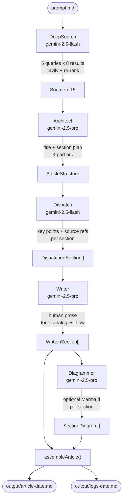

# article-companion

A multi-agent system for writing high-quality Medium-style articles from a one-line brief. You describe a topic; the pipeline researches it, designs a structure, fills it with sourced substance, writes human-sounding prose, and optionally adds explanatory diagrams — all in one command.

---

## How it works

The pipeline is a fixed sequence of 5 specialized agents, each consuming the previous one's structured output. There is no dynamic routing or supervisor: the flow is deterministic.



### Agents in detail

| Agent | Model | Role |
|---|---|---|
| **DeepSearch** | `gemini-2.5-flash` | Generates 5 search queries, runs them in parallel via Tavily (up to 8 results each), deduplicates, then re-ranks to keep the 15 most relevant sources. |
| **Architect** | `gemini-2.5-pro` | Designs the article structure: a compelling title (must contain a number, claim, or tension), a hook intro, body sections with standalone headings, and a conclusion with a CTA. Word budget is derived from the brief. |
| **Dispatch** | `gemini-2.5-flash` | For each section, extracts the key points and substance from the sources. Produces bullet facts and source references — no prose yet. |
| **Writer** | `gemini-2.5-pro` | Rewrites each dispatched section into final Markdown prose: analogy-first explanations, conversational tone, enforced Medium voice and formatting rules. |
| **Diagrammer** | `gemini-2.5-pro` | Evaluates each section and, where a diagram genuinely helps, produces a Mermaid diagram with a caption. Sections where a visual adds nothing are skipped. |

### Data flow types

```
DeepSearch  → Source[]
Architect   → ArticleStructure  { title, targetWordCount, sections: ArticleSection[] }
Dispatch    → DispatchedSection[]  { ...ArticleSection, keyPoints, sourceRefs }
Writer      → WrittenSection[]     { id, heading, markdown }
Diagrammer  → SectionDiagram[]     { sectionId, include, mermaid, caption }
```

### Model tiers

Two Gemini tiers are used deliberately:

- **Flash** (`gemini-2.5-flash`): speed and cost, for search ranking and substance dispatch.
- **Pro** (`gemini-2.5-pro`): higher quality, for article planning, final writing, and diagrams.

---

## Project structure

```
prompt.md                  # your article brief (edit this)
.env.local                 # API keys (gitignored)
source/
  index.ts                 # entry point: reads prompt.md, runs pipeline, writes outputs
  workflow.ts              # sequential orchestrator
  config/
    env.ts                 # env validation
    models.ts              # makeGoogleModel("flash"|"pro") factory
  types/index.ts           # shared interfaces
  agents/
    deepSearch.ts          # 15 best sources via Tavily + Gemini ranking
    architect.ts           # article structure + title rules
    dispatch.ts            # substance mapping per section
    writer.ts              # prose generation + assembleArticle()
    diagrammer.ts          # optional Mermaid diagrams
  utils/
    io.ts                  # read prompt.md, write output files
    logger.ts              # WorkflowLogger, renders logs-<date>.md
output/                    # generated files (gitignored)
```

---

## Setup

### Prerequisites

- [Bun](https://bun.sh) >= 1.0
- A [Google AI Studio](https://aistudio.google.com/apikey) API key (Gemini)
- A [Tavily](https://app.tavily.com/) API key (web search)

### Install

```bash
bun install
```

### Configure environment

Copy `.env.example` to `.env` and fill in your keys:

```bash
cp .env.example .env
```

```env
GOOGLE_API_KEY=your_google_ai_key
TAVILY_API_KEY=your_tavily_key
```

Bun loads `.env` natively — no extra tooling needed.

---

## Usage

### 1. Write your brief

Copy `.prompt.example.md` to `.prompt.md` and edit with you article topic :

```bash
cp .prompt.example.md .prompt.md
```

The brief is in English. You can specify a target length and audience; if you don't, the Architect defaults to a ~1200-word article.

Examples:

```
Write an article about why most teams underestimate the cost of technical debt.
```

```
Write a 2000-word article for senior engineers about the trade-offs of event-driven architecture vs. request-response in distributed systems.
```

### 2. Run

```bash
bun run start
```

The pipeline logs progress to the console as each agent runs. When it finishes, two files are written to `output/`:

- `article-<date>.md` — the final article in Markdown, ready to paste into Medium.
- `logs-<date>.md` — per-agent debug information (model used, duration, notes).

---

## Output example

```
output/
  article-2026-06-12.md   ← paste directly into Medium
  logs-2026-06-12.md      ← DeepSearch: 5 queries, 34 candidates → 15 kept (1.2s) ...
```
